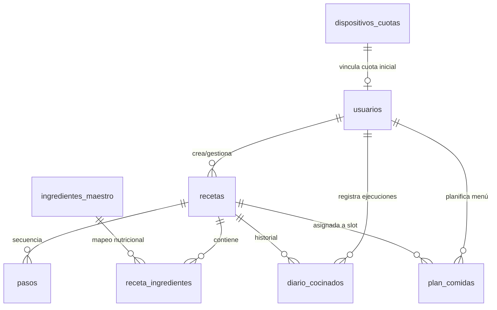

# Miga — Documento Maestro de Arquitectura y Estado del Sistema (Octubre 2026)

**Versión del Documento:** 2.1.0-PROD  
**Fecha de Emisión:** 24 de Octubre de 2026  
**Autor:** Lead Software Architect & Technical Lead  
**Estado del Sistema:** Producción / Pista de Pruebas Cerradas (Google Play Console)  
**Versión Nativa Android:** `versionCode 5` | `versionName "2.1.0"`  

---

## 1. VISIÓN DEL PRODUCTO Y STACK TECNOLÓGICO

### 1.1. Visión y Propósito
**Miga** es una plataforma culinaria-clínica de alta precisión orientada a dispositivos móviles y web. Permite a los usuarios ingerir recetas desde cualquier red social (TikTok, Instagram Reels, YouTube Shorts, webs gastronómicas) o capturas manuales, estructurarlas automáticamente mediante IA multimodal y adaptarlas en tiempo real según el perfil clínico (alergias, intolerancias, FODMAP, celiaquía) y nivel técnico culinario del usuario, con escalado termodinámico de raciones y lista de compra interactiva.

```
 [Red Social / Vídeo / Web] ──> [Extracción Ingestión IA] ──> [Receta Normalizada]
                                                                        │
 [Perfil Clínico / Alérgenos] ──────────────────────────────────────────┼──> [Motor Culinario & IA]
                                                                        │      - Cortafuegos clínico
                                                                        │      - Escalado termodinámico
                                                                        │      - 3 Alternativas dinámicas
                                                                        ▼
                                                         [Modo Cocina / Modo Compra]
```

### 1.2. Core Stack Tecnológico

| Capa | Tecnología | Rol y Especificación Técnica |
| :--- | :--- | :--- |
| **Framework Web** | **Next.js 16.4.3** | App Router, Turbopack, Server Components, Server Actions seguras, proxy middleware. |
| **Lenguaje** | **TypeScript 5.x** | Tipado estricto end-to-end, validación de schemas en tiempo de compilación. |
| **Diseño y Estilos** | **Tailwind CSS v4** | Utilidades CSS, temas cálidos editoriales (paleta tierra/ámbar `#a86224`), tipografía serif editorial (`font-serif-recipe`). |
| **Gestión de Estado** | **Zustand 5.0.15** | Stores reactivos y ultraligeros: `useProfileStore`, `useRecipeStore`, `useLanguageStore`, `useAuthStore`. |
| **Backend & DB** | **Supabase (PostgreSQL 15)** | Auth (JWT / PKCE), PostgreSQL con RLS (Row Level Security), Storage buckets (`recetas_fotos`). |
| **Pagos y Facturación** | **Stripe 23.0.0** | Stripe Checkout (Suscripción recurrente mensual 3,50 €/mes), Webhook handler con verificación criptográfica. |
| **Motor de IA** | **Google Gemini API** (`@google/genai`) | Modelos `gemini-2.5-flash` / `gemini-1.5-pro` para extracción estructurada, adaptación in-line y sustitución de ingredientes. |
| **Plataforma Móvil** | **Capacitor 8.5.3** | Shell nativa Android/iOS (`@capacitor/android`, `@capacitor/device`), AdMob Rewarded Ads (`@capacitor-community/admob`). |
| **Componentes UI** | **Vaul 1.1.2** & **Lucide React** | Bottom Sheet Drawer nativo táctil de alto rendimiento, iconografía adaptativa y responsive. |

---

## 2. MODELO DE DATOS Y PERSISTENCIA (SUPABASE / POSTGRESQL)

El sistema opera sobre una base de datos PostgreSQL alojada en Supabase con integridad referencial estricta y políticas de seguridad por fila (RLS).

### 2.1. Diagrama Entidad-Relación



### 2.2. Esquema Detallado de Tablas

#### A. Tabla `usuarios` (Perfiles y Suscripciones)
- `id` (`UUID`, PK, referenciada a `auth.users.id`).
- `email` (`TEXT`, NOT NULL).
- `nombre` (`TEXT`, NULL).
- `avatar_url` (`TEXT`, NULL).
- `preferencias_dieteticas` (`TEXT[]`): Almacena objetivos clínicos y patrón alimentario (ej: `['FODMAP', 'Baja en Histamina', 'Mediterránea']`).
- `alergenos` (`TEXT[]`): Catálogo oficial de alérgenos UE activos (ej: `['gluten', 'lacteos', 'crustaceos']`).
- `objetivo_calorico_diario` (`INTEGER`, NULL).
- `raciones_defecto` (`INTEGER`, DEFAULT 2).
- `nivel_culinario` (`TEXT`, DEFAULT 'Principiante'): Valores válidos: `'Principiante' | 'Intermedio' | 'Avanzado'`.
- `plan_suscripcion` (`TEXT`, DEFAULT 'gratis'): `'gratis' | 'pro'`.
- `capturas_mes_actual` (`INTEGER`, DEFAULT 0): Contador de recetas importadas en el ciclo activo.
- `fecha_ultimo_reinicio` (`TIMESTAMPTZ`): Marca temporal del último reset de ciclo mensual.
- `antiguedad_ciclos_mes` (`INTEGER`, DEFAULT 0).
- `stripe_customer_id` (`TEXT`, NULL).
- `stripe_subscription_id` (`TEXT`, NULL).
- `created_at` / `updated_at` (`TIMESTAMPTZ`).

#### B. Tabla `recetas` (Entidad Principal de Receta)
- `id` (`UUID`, PK).
- `usuario_id` (`UUID`, FK `usuarios.id`).
- `titulo` (`TEXT`, NOT NULL).
- `descripcion` (`TEXT`, NULL).
- `imagen_portada_url` / `foto_url` (`TEXT`, NULL).
- `tiempo_preparacion_min` / `tiempo_coccion_min` / `tiempo_total_min` (`INTEGER`).
- `porciones` (`INTEGER`, NOT NULL, DEFAULT 2).
- `dificultad` (`TEXT`): `'facil' | 'media' | 'dificil' | 'alta'`.
- `fuente_tipo` (`TEXT`): `'tiktok' | 'instagram' | 'youtube' | 'web' | 'manual' | 'foto_manuscrita' | 'audio' | 'pdf'`.
- `fuente_url` (`TEXT`, NULL): Enlace directo al vídeo o artículo original.
- `calorias_por_porcion`, `proteinas_por_porcion`, `carbohidratos_por_porcion`, `grasas_por_porcion`, `fibra_por_porcion` (`NUMERIC`).
- `es_favorita` (`BOOLEAN`, DEFAULT false).
- `puntuacion` (`NUMERIC`, DEFAULT 0).
- `es_publica` (`BOOLEAN`, DEFAULT false).
- `etiquetas` (`TEXT[]`): Etiquetas semánticas para categorización en recetario.
- `receta_original` (`JSONB`, NULL): Copia de seguridad del snapshot original para reversión de adaptaciones.
- `created_at` / `updated_at` (`TIMESTAMPTZ`).

#### C. Tablas Hijas y Relacionadas
1. `receta_ingredientes`:
   - `id`, `receta_id` (FK), `ingrediente_maestro_id` (FK opcional).
   - `nombre_crudo` (`TEXT`), `nombre_limpio` (`TEXT` canónico sin cantidades).
   - `cantidad` (`NUMERIC`), `unidad` (`TEXT`), `gramos_calculados` (`NUMERIC`).
   - `pasillo_supermercado` (`TEXT`): Categoría para lista de compra inteligente (Frutería, Carnicería, Pescadería, Despensa...).
   - `notas` (`TEXT`), `es_opcional` (`BOOLEAN`), `orden` (`INTEGER`).
2. `pasos`:
   - `id`, `receta_id` (FK), `orden` (`INTEGER`), `instruccion` (`TEXT`), `consejo_pro` (`TEXT`), `tiempo_estimado_min` (`INTEGER`), `temperatura_celsius` (`INTEGER`).
3. `diario_cocinados`:
   - Registro de ejecución: `receta_id`, `usuario_id`, `fecha_cocinado`, `calificacion`, `notas_cocinero`, `modificaciones_realizadas`, `foto_resultado_url`.
4. `plan_comidas`:
   - `usuario_id`, `receta_id`, `fecha`, `slot` (`'desayuno' | 'almuerzo' | 'cena' | 'snack'`).
5. `dispositivos_cuotas`:
   - Control anónimo antifraude de cuotas para dispositivos móviles (`device_id`, `capturas_mes_actual`).

### 2.3. Políticas RLS y Sincronización con Zustand (`useProfileStore`)
- **Row Level Security (RLS)**: Cada usuario únicamente puede leer y modificar sus propios registros (`auth.uid() = usuario_id`).
- **Store Reactivo (`useProfileStore`)**:
  - `fetchProfile(userId)`: Carga el perfil desde Supabase al iniciar sesión.
  - `updateProfile(updates)`: Ejecuta mutación optimista local, persistencia en Postgres y actualización inmediata en el estado global.
  - Detección de cambios sucios (`isDirty`): Si el usuario edita su perfil y navega hacia atrás sin pulsar guardar, el listener `beforeunload` y el unmount hook guardan automáticamente los datos mediante `updateUserProfileAction`.

---

## 3. MOTOR CLÍNICO Y MOTOR DE IA (GEMINI API)

### 3.1. Diccionario Canónico Culinario-Clínico (`clinicalDictionary.ts`)
El sistema integra una base de conocimiento médico-culinaria de más de 2.500 líneas de código basada en el **Reglamento UE 1169/2011** y protocolos clínicos de nutrición:
- **14 Alérgenos Obligatorios UE**: Gluten, Crustáceos, Huevos, Pescado, Cacahuetes, Soja, Lácteos, Frutos de cáscara, Apio, Mostaza, Sésamo, Sulfitos, Altramuces y Moluscos.
- **Protocolos Clínicos y Patologías Digestivas**:
  - **FODMAP** (Síndrome del Intestino Irritable / SII): Detección estricta de fructooligosacáridos, galactooligosacáridos, polioles, cebolla, ajo, legumbres secas.
  - **Celiaquía / Cero Gluten**: Detección de trazas y cereales prohibidos (trigo, cebada, centeno, espelta, avena no certificada, salsa de soja tradicional, cuscús).
  - **Baja en Histamina**: Exclusión de alimentos fermentados, madurados, conservas, espinacas, berenjenas, tomates en conserva y mariscos.
  - **Antiinflamatoria / Salud Cardiovascular / Diabetes & Bajo IG / Renal / Psoriasis**.
- **Lemmatización y Detección de Términos**:
  - Extracción de raíces singulares y plurales (`getSingularStem`).
  - Regex con límites de palabra para evitar falsos positivos (ej. "ajo" no empareja con "marajó").
  - Ordenación de exclusiones por longitud descendente para emparejar términos específicos prioritariamente (ej. "leche evaporada" antes que "leche").

### 3.2. Semáforo Clínico (`checkRecipeClinicalCompatibility`)
Evalúa los ingredientes de la receta frente al perfil del usuario y genera un informe estructurado:
- **`CRÍTICO` (Rojo / Rose)**: Conflictos con alérgenos severos o patologías de tolerancia cero (Celiaquía, Anafilaxia). Bloquea la preparación y muestra tarjeta de alarma visual con pulso de atención.
- **`MODERADO` (Ámbar / Amber)**: Conflictos clínicos dependientes de dosis o digestibilidad (FODMAP, Intolerancia a la lactosa, Histamina).
- **`SEGURO` (Verde / Emerald)**: Receta 100% compatible con los alérgenos y objetivos del usuario.

### 3.3. Server Actions de Inteligencia Artificial

#### A. Adaptación In-Line Completa (`adaptRecipeAction.ts`)
- **Prompt Engineering**: Actúa como Chef Consultor y Nutricionista Clínico. Reescribe el JSON de la receta preservando ratios y técnica culinaria.
- **Etiquetado Visual con `<mark>`**: Envuelve los ingredientes y pasos adaptados en etiquetas `<mark>` (ej. `<mark>Bebida de avena</mark>`, "Añade <mark>los 200 ml de bebida de avena</mark>").
- **Deduplicación y Nombres Canónicos**: El campo `nombre_limpio` contiene única y exclusivamente el nombre del alimento sin cantidades ni unidades (prohibido "300 g de tofu").
- **Persistencia y Reversión**: Permite guardar la receta adaptada en Supabase o revertir en cualquier momento al estado de `receta_original`.

#### B. Sustitución de 3 Alternativas (`suggestSubstituteAction.ts`)
- **Schema Estricto JSON**:
  ```typescript
  minItems: 3,
  maxItems: 3
  ```
- Garantiza **exactamente tres opciones culinarias complementarias y diferenciadas**:
  1. *Opción 1*: Reemplazo directo de textura y comportamiento culinario.
  2. *Opción 2*: Optimización nutricional / metabólica / bajo índice glucémico.
  3. *Opción 3*: Alternativa vegetal, ligera o libre de alérgenos.
- **Ficha Técnica Detallada**:
  - `nombre_sustituto`: Nombre canónico limpio.
  - `etiqueta_dinamica`: Contextual al plato (ej: "Tubérculo de bajo IG").
  - `categoria_icono`: `'vegetal' | 'proteina' | 'lacteo' | 'cereal' | 'despensa' | 'general'`.
  - `cantidad_sugerida`: Ratio de conversión exacto (ej: "1:1" o "150g por cada 100g").
  - `razon_culinaria`: Reacción al fuego, humedad y evaporación.
  - `beneficio_nutricional`: Justificación macro y micronutricional.
  - `modo_uso`: Instrucción de incorporación al fuego/sartén/horno.

### 3.4. Motor de Escalado Culinario Inteligente (`scaler.ts`)
La cocina no escala de forma lineal. Un cambio de raciones de 2 a 8 personas no puede multiplicar por 4 la sal ni el aceite sin arruinar la receta.

| Categoría Culinaria | Exponente de Escalado | Comportamiento Físico-Químico |
| :--- | :---: | :--- |
| **`SPICE_AND_SALT`** | $\text{factor} = \text{ratio}^{0.72}$ | Evita saturación gustativa y sobre-salado en grandes volúmenes. |
| **`COOKING_FAT`** | $\text{factor} = \text{ratio}^{0.65}$ | Ajustado a la superficie bidimensional de contacto de ollas y sartenes. |
| **`LEAVENER_THICKENER`** | $\text{factor} = \text{ratio}^{0.78}$ | Control de fuerza gasificante y gelatinización de almidones. |
| **`ABSORPTION_GRAINS`** (Arroz, legumbres, pastas) | $\text{factor} = \text{ratio}^{1.00}$ (**Lineal**) | **Regla Crítica**: Los caldos y agua en arroces y legumbres absorben proporcionalmente grano a grano. Su escalado es **estrictamente lineal**. |
| **`REDUCTION_LIQUID`** (Salsas puras sin grano) | $\text{factor} = \text{ratio}^{0.95}$ | Amortiguación suave para compensar menor evaporación relativa. |
| **`BULK`** (Carnes, verduras base) | $\text{factor} = \text{ratio}^{1.00}$ (**Lineal**) | Escalado estándar proporcional. |
| **`TIEMPO_COCCION`** | $\text{factor} = \text{ratio}^{0.32}$ | No duplica el tiempo de horno ni sellado al duplicar raciones. |

---

## 4. MODELO DE NEGOCIO Y CORTAFUEGOS FREEMIUM

Miga implementa una arquitectura híbrida de monetización diseñada para maximizar la conversión protegiendo los costes de inferencia de IA.

```
                  ┌──────────────────────────────┐
                  │ Intento de Acción Avanzada   │
                  │ (Adaptar Receta / Sustituir) │
                  └──────────────┬───────────────┘
                                 │
                     ¿Es Usuario 'pro' o VIP?
                                 │
                   ┌─────────────┴─────────────┐
                  SÍ                           NO
                   │                           │
          [Invocar Gemini IA]        [Cortafuegos Frontend]
                   │                 (Bloquea consumo de tokens)
                   ▼                           │
        [Respuesta Estructurada]               ▼
                                     [Abrir ProSubscriptionModal]
                                     - 1º Plan PRO (3,50€/mes)
                                     - 2º Anuncio Recompensado AdMob
                                     - 3º Canje de Código Promocional
```

### 4.1. Cortafuegos en Capa de Cliente (`IngredientRow.tsx`)
En el componente `IngredientRow.tsx`, antes de disparar `suggestSubstituteAction`, se evalúa la condición de suscripción:
```typescript
const handleOpenDrawer = () => {
  if (!isPro) {
    setShowProModal(true);
    return; // Retorno inmediato: no se consume un solo token de Gemini
  }
  // Flujo PRO autorizado...
};
```

### 4.2. Flujo de Facturación y Presentación de Opciones (`/pro` & `/billing`)
La jerarquía de conversión en `BillingPlanView.tsx` está estrictamente estructurada por prioridad comercial:
1. **1º Lugar (Principal)**: Tarjeta del **Plan PRO Mensual a 3,50 €/mes** con pasarela Stripe Checkout, destacando insignias de valor, soporte ilimitado y cancelación en un clic.
2. **2º Lugar (Alternativa Gratuita)**: Tarjeta de **Anuncio Recompensado (Rewarded Video)** vía AdMob en app móvil o simulación patrocinada en web, otorgando créditos temporales de recetas.
3. **3º Lugar**: Canje de **Códigos Promocionales / VIP** para activaciones directas sin pasar por pasarela.
4. **4º Lugar**: Resumen detallado de beneficios PRO (adaptación ilimitada a alérgenos, sustituciones con IA, modo cocina con pantalla siempre encendida, etc.).

---

## 5. ARQUITECTURA DE UI/UX IMPLEMENTADA (MOBILE-FIRST)

La interfaz de usuario ha sido concebida bajo criterios estrictos de ergonomía móvil, navegación con una sola mano y contención visual.

### 5.1. Vista de Colección y Recetario (`/recipes/collection`)
- **Cuadrícula de 2 Columnas Móvil (`grid-cols-2`)**: En pantallas pequeñas las recetas se disponen en 2 columnas equilibradas (`gap-2.5 sm:gap-4`), optimizando el espacio vertical y mostrando más contenido de un vistazo.
- **Tarjetas Contenidas**: Imágenes con ratio fija, badges de tiempo y dificultad protegidos contra desbordes tipográficos.
- **Filtrado Categorial Determinista**: 12 categorías culinarias canónicas (Desayunos, Pastas, Carnes, Pescados, Postres, etc.) con conteo numérico de recetas y selección horizontal táctil.

### 5.2. Vista de Perfil (`/profile`)
- **Cabecera Compacta**: Avatar inline de 48px con tipografía de bienvenida refinada y badge de suscripción.
- **Selector Clínico en Bottom Sheet (`vaul`)**: La selección de Patologías y Objetivos Clínicos se abre en un cajón inferior deslizable, erradicando cajas de texto redundantes o descripciones internas excesivas.
- **Protección Antiperdida de Cambios (`isDirty`)**: Memorización de instantánea inicial y guardado automático transparente mediante `updateUserProfileAction` al abandonar la pantalla o recargar.

### 5.3. Vista de Detalle de Receta (`/recipes/[id]`)
- **Cabecera Tripartita Equilibrada (`RecipeDetailHeader.tsx`)**:
  - *Izquierda*: Botón de retorno táctil compacto `← Recetario`.
  - *Centro*: Píldora destacada `▷ Ver vídeo` (o fuente original) posicionada de forma absoluta y centrada.
  - *Derecha*: Menú desplegable de usuario (`UserDropdownMenu`) y badge de dificultad.
- **Título Editorial y Descripción Colapsable**: Título `h1` en `font-serif-recipe` con truncado elegante de descripción a 2 líneas (`line-clamp-2`) y conmutador nativo `"Ver más"` / `"Ver menos"`.
- **Semáforo Clínico en Acordeón**: Tarjeta de alerta colapsable con indicador de severidad (`Crítico` / `Moderado`) y chips claros de ingredientes causantes.
- **Segmented Control Táctil**: Conmutador tipo píldora entre **Modo Cocina** (con escalado de raciones y Wake Lock) y **Lista de Compra** (organizada por pasillos de supermercado con casillas de verificación persistentes en `localStorage`).
- **Lista Vertical de Alternativas**: Sustitución de carruseles horizontales con scroll por una **lista vertical de tarjetas de 100% de ancho**, asegurando que las 3 opciones de IA y sus fichas técnicas se lean sin desbordamiento horizontal.

### 5.4. Vista de Configuración (`/settings`)
- **Selector Numérico Limpio**: Selector de raciones por defecto con contador numérico centralizado e incremento táctil (`-` y `+`), eliminando botones preconfigurados redundantes.
- **Persistencia Dual**: Sincronización instantánea en `localStorage` y en la base de datos Supabase con feedback visual (`Guardado`).

### 5.5. Blindaje del Viewport
- Aplicación de clases de contención en contenedores principales y cabeceras:
  ```css
  w-full max-w-full overflow-x-hidden
  ```
- Erradicación total de cualquier comportamiento de scroll horizontal involuntario en Safari iOS y WebView de Android.

---

## 6. CHECKLIST DE RUTAS, ESTADO DE TESTS Y PROCEDIMIENTO DE COMPILACIÓN

### 6.1. Inventario de Rutas y Modos de Renderizado

| Ruta | Modo de Renderizado | Propósito / Funcionalidad |
| :--- | :---: | :--- |
| `/` | **ƒ (Dinámico)** | Landing / Redirección inteligente según estado de sesión. |
| `/login` | **○ (Estático)** | Acceso con credenciales o enlace mágico de Supabase. |
| `/register` | **○ (Estático)** | Registro de nuevos usuarios. |
| `/privacidad` | **○ (Estático)** | Términos legales, privacidad y política de cookies. |
| `/update-password` | **○ (Estático)** | Formulario de restablecimiento de contraseña. |
| `/_not-found` | **○ (Estático)** | Página 404 personalizada con diseño editorial. |
| `/recipes` | **ƒ (Dinámico)** | Explorador y buscador rápido de recetas. |
| `/recipes/collection` | **ƒ (Dinámico)** | Colección personal organizada por categorías. |
| `/recipes/[id]` | **ƒ (Dinámico)** | Detalle de receta, cocina interactiva, escalado y sustituciones. |
| `/collection` | **ƒ (Dinámico)** | Alias / redirección a la colección activa. |
| `/profile` | **ƒ (Dinámico)** | Gestión de perfil, objetivos clínicos y suscripción. |
| `/settings` | **ƒ (Dinámico)** | Raciones por defecto, wake lock y preferencias. |
| `/settings/billing` | **ƒ (Dinámico)** | Acceso a panel de facturación desde ajustes. |
| `/billing` | **ƒ (Dinámico)** | Vista principal de suscripción PRO, AdMob y VIP. |
| `/pro` | **ƒ (Dinámico)** | Landing y checkout del Plan PRO. |
| `/meal-planner` | **ƒ (Dinámico)** | Planificador semanal de comidas. |
| `/share-target` | **ƒ (Dinámico)** | Receptor de Web Share Target API / intents de Android para ingesta directa de URLs desde redes sociales. |
| `/api/stripe/checkout` | **ƒ (API Route)** | Creación de sesiones de Stripe Checkout. |
| `/api/stripe/webhook` | **ƒ (API Route)** | Receptor y validador de webhooks de eventos Stripe. |
| `/api/feedback` | **ƒ (API Route)** | Recepción de feedback de usuarios y reporte de incidencias. |
| `/auth/callback` | **ƒ (API Route)** | Intercambio de tokens de autenticación OAuth/Supabase. |

### 6.2. Comandos de Verificación de Calidad

Para asegurar la estabilidad absoluta antes de cualquier despliegue, deben ejecutarse y superar los siguientes checks:

1. **Verificación de Tipado TypeScript (Estricto, 0 errores)**:
   ```powershell
   npx tsc --noEmit
   ```
2. **Compilación de Producción Next.js**:
   ```powershell
   npm run build
   ```

### 6.3. Procedimiento Oficial de Release Android (.aab)

Para publicar una nueva versión en **Google Play Console (Pista de pruebas cerradas o producción)**:

1. **Compilación Web de Producción**:
   ```powershell
   npm run build
   ```
2. **Sincronización de Assets y Plugins con Capacitor**:
   ```powershell
   npx cap sync android
   ```
3. **Incremento de Versión en `android/app/build.gradle`**:
   - Incrementar `versionCode` en `+1` (ej. de `4` a `5`).
   - Ajustar `versionName` según versionado semántico (ej. `"2.1.0"`).
4. **Compilación y Firma del Bundle de Release**:
   ```powershell
   cd android
   .\gradlew.bat bundleRelease
   ```
5. **Ubicación del Artefacto Final**:
   ```text
   android/app/build/outputs/bundle/release/app-release.aab
   ```
   *El archivo generado está firmado criptográficamente con `miga-release-key.keystore` (alias `miga-alias`) y listo para su subida directa a la consola de Google Play.*

---

## 7. HISTORIAL DE VERSIONES Y AUDITORÍA RECIENTE

- **v2.1.0 (Octubre 2026 - Actual)**:
  - Consolidación del cortafuegos freemium en `IngredientRow.tsx`.
  - Implementación de 3 alternativas garantizadas (`minItems: 3, maxItems: 3`) con ficha técnica culinaria expandible.
  - Corrección de escalado lineal para líquidos de cocción y absorción en arroces, cereales y legumbres.
  - Erradicación completa de desbordes horizontales en móvil mediante lista vertical de alternativas.
  - Cuadrícula de 2 columnas en móvil para la colección de recetas.
  - Cabecera de detalle de receta optimizada con botón central de vídeo y navegación fluida.
  - Compilación de Android Bundle (`versionCode 5`, `versionName "2.1.0"`).
- **v2.0.2**:
  - Ajustes de estabilidad en persistencia de recetas adaptadas en Supabase (`receta_original`).
- **v2.0.1**:
  - Integración de AdMob Rewarded Ads en Capacitor y pasarela Stripe Checkout en producción.

---
*Documento consolidado y certificado por el Lead Software Architect de Miga.*
