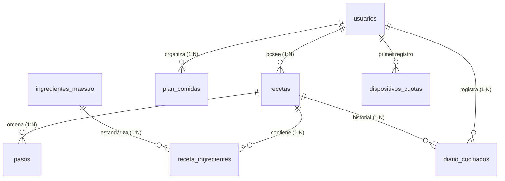

# MIGA APP — STATE OF THE APP (DOCUMENTO MAESTRO DE ARQUITECTURA)

**Documento:** Informe de Estado Actual, Arquitectura Técnica y Funcional  
**Versión de la Aplicación:** 2.0.0 (Producción — Freemium / Premium)  
**Última Actualización:** 20 de Octubre de 2026  
**Entorno de Ejecución:** Web (PWA instalable) y Móvil Nativo (Capacitor para Android e iOS)

---

## 1. INTRODUCCIÓN Y VISIÓN GENERAL

### 1.1 Propósito de Miga
**Miga** es una plataforma culinaria integral diseñada para transformar el caos de las recetas dispersas en redes sociales (TikTok, Instagram Reels, YouTube, Facebook, blogs gastronómicos o notas sueltas) en un **recetario digital estandarizado, interactivo y adaptado clínicamente**.

A diferencia de un simple gestor de notas o marcadores de enlaces, Miga extrae la esencia técnica de cualquier elaboración culinaria: ingredientes con cantidades numéricas exactas, cálculo volumétrico en gramos, tiempos de preparación y cocción, técnicas explicadas paso a paso, perfiles nutricionales estimados y adaptación médica ante alergias o patologías digestivas.

### 1.2 Principios Fundamentales de Ingeniería

1. **Rigor Clínico y Cortafuegos Nutricional:** La salud del usuario es una restricción de primer orden. El motor cruza las patologías clínicas (FODMAP, SII, Celiaquía, Antirreflujo, Histamina, etc.) y alérgenos del usuario para inyectar directivas médicas obligatorias que impiden que la inteligencia artificial sugiera ingredientes lesivos.
2. **Extracción Multimodal Autónoma:** Capacidad de inferir recetas completas sin requerir que el usuario transcriba texto a mano. Soporta enlaces de vídeo corto, vídeos largos con o sin transcripción, capturas de pantalla, fotos de libros de cocina y documentos PDF o Word.
3. **Esquema JSON Estricto y Determinista:** Uso riguroso de `responseSchema` mediante el SDK oficial `@google/genai`. Se prohíbe el texto libre desestructurado; cada respuesta de la IA debe conformar un objeto tipado con arrays atómicos de ingredientes y pasos secuenciales.
4. **Sostenibilidad Económica y Control de Costes:** Fijación estricta al modelo más eficiente del mercado (**Gemini 3.1 Flash Lite**), respaldado por un cortafuegos de cuotas mensuales en el servidor, protección anti-fraude por hardware físico y un modelo de negocio de producción basado en Stripe y AdMob.

---

## 2. STACK TECNOLÓGICO Y ESTADO DE DEPENDENCIAS

| Tecnología / Dependencia | Versión | Tipo / Capa | Rol y Responsabilidad Arquitectónica |
| :--- | :---: | :---: | :--- |
| **Next.js** | `16.4.0` | Framework Core | Arquitectura App Router, Server Actions (`'use server'`), renderizado híbrido (RSC/SSR) y optimización Turbopack. |
| **React / React DOM** | `19.3.0` | UI Runtime | Concurrencia, transiciones (`useTransition`), Server Components y hooks modernos. |
| **@google/genai** | `^2.28.0` | Motor de IA | SDK oficial de Google para invocación multimodal de Gemini 3.1 Flash Lite con esquemas JSON estrictos y File API. |
| **@supabase/supabase-js** | `^2.117.3` | BaaS / Base de Datos | Cliente PostgreSQL, autenticación, storage de medios y cliente administrativo con Service Role. |
| **@supabase/ssr** | `^0.12.7` | Auth Middleware | Gestión segura de sesiones de Supabase mediante cookies HTTP en middleware y Server Actions. |
| **Stripe** | `^23.0.0` | Pagos / Suscripción | Creación de Checkout Sessions recurrentes y procesamiento de webhooks para altas, bajas e impagos. |
| **@capacitor/core** | `^8.5.3` | Capa Nativa | Puente (bridge) de comunicación entre la aplicación web y el sistema operativo móvil. |
| **@capacitor/android** | `^8.5.3` | Plataforma Móvil | Runtime de compilación Android Studio (`com.migaapp.app`). |
| **@capacitor/device** | `^8.0.0` | Seguridad Hardware | Identificación física del hardware (`Device.getId()`) para prevención de fraude multi-cuenta. |
| **@capacitor-community/admob** | `^8.2.1` | Publicidad Móvil | Ejecución de anuncios de vídeo bonificado (Rewarded Video) en entornos nativos iOS/Android. |
| **Zustand** | `^5.0.15` | Estado Cliente | Stores atómicos ligeros para perfil de usuario, idioma, autenticación y colecciones. |
| **Tailwind CSS** | `^4.0.0` | Sistema de Diseño | Motor de estilos utilitario de alto rendimiento con tokens artesanales y diseño responsive. |
| **Lucide React** | `^1.55.0` | Iconografía | Sistema iconográfico vectorial coherente para toda la interfaz. |
| **Resend / Nodemailer** | `^6.34.1` | Mensajería | Envío transaccional de correos de soporte, feedback y notificaciones de cuenta. |
| **btch-downloader / yt-dlp** | `^6.4.0` | Descarga de Medios | Extracción de metraje audiovisual de YouTube/redes cuando no existen transcripciones públicas. |

---

## 3. CAPACIDADES DE LA APLICACIÓN (QUÉ PUEDE HACER EL USUARIO)

### 3.1 Captura Rápida y Estandarización Universal
* **Ingesta desde Redes Sociales:** El usuario pega enlaces de TikTok, Instagram Reels, YouTube Shorts, YouTube estándar o Facebook Vídeos. La aplicación analiza el audio, vídeo y metadatos para generar la receta en segundos.
* **Captura Fotográfica y Documental:** Permite fotografiar un libro de cocina o subir capturas de pantalla, archivos PDF, Word o notas manuscritas.
* **Ingesta por Texto Plano:** Permite copiar y pegar notas desordenadas de WhatsApp, blogs o correos.

### 3.2 Adaptación Culinaria y Perfil Clínico
* **Personalización Médica:** Configuración en el perfil de patologías (FODMAP, SII, Baja en Histamina, Sin Gluten, Dieta Blanda, Antirreflujo, etc.) y alérgenos de declaración obligatoria.
* **Adaptación con un Clic:** Desde la vista de cualquier receta, el usuario puede pulsar *"Adaptar a mi perfil"*. Gemini reescribe ingredientes y pasos sustituyendo los elementos conflictivos por alternativas seguras y resaltando los cambios con etiquetas `<mark>`.

### 3.3 Herramientas Interactivas de Cocina en la UI
* **Recálculo Dinámico de Raciones ([`ServingsScaler.tsx`](file:///c:/Users/Nacho/OneDrive/Desktop/recetario-app/src/components/recipes/ServingsScaler.tsx)):** Multiplicador de comensales en tiempo real (1 a 20 porciones). Escala automáticamente las cantidades numéricas y gramos de todos los ingredientes sin alterar la receta base.
* **Modo Lista de la Compra ([`ShoppingListMode.tsx`](file:///c:/Users/Nacho/OneDrive/Desktop/recetario-app/src/components/recipes/ShoppingListMode.tsx)):**
  * Agrupación automática por pasillos de supermercado (*Frutas y Verduras*, *Carnes*, *Lácteos*, *Despensa*, *Especias*).
  * Checklist interactivo con persistencia local en `localStorage` (no se borra al bloquear el teléfono en el supermercado).
  * Función de copia en formato texto para compartir la lista por mensajería.
* **Modo "Manos en la Masa" ([`RecipeWakeLock.tsx`](file:///c:/Users/Nacho/OneDrive/Desktop/recetario-app/src/components/recipes/RecipeWakeLock.tsx)):**
  * Integración con la API nativa de pantalla activa (**Screen Wake Lock API**).
  * Mantiene la pantalla encendida indefinidamente mientras el usuario cocina, evitando bloqueos con las manos sucias o húmedas.
  * Reanudación automática al recuperar la visibilidad de la pestaña.
* **Diario de Cocinados y Planificador:** Registro de fotos reales del plato cocinado con valoración de 1 a 5 estrellas, y organizador de menús semanales (*desayuno*, *almuerzo*, *cena*, *snack*).

---

## 4. ARQUITECTURA DEL MOTOR IA Y DICCIONARIO CLÍNICO

```
┌────────────────────────────────────────────────────────────────────────┐
│                        ENTRADA (URL / TEXTO / ARCHIVO)                 │
└───────────────────────────────────┬────────────────────────────────────┘
                                    │
    ┌───────────────────────────────┴───────────────────────────────┐
    ▼                                                               ▼
[URL YouTube / Redes]                                    [Foto / Documento / Texto]
Resolución de Transcripción / Metadatos                  Subida directa a Gemini Files API
                                    │                               │
                                    └───────────────┬───────────────┘
                                                    ▼
                               ┌────────────────────────────────────────┐
                               │     CONSTRUCCIÓN DEL PROMPT MASTER     │
                               │  + Cortafuegos Clínico de Exclusiones  │
                               │  +responseJsonSchema Estricto         │
                               └────────────────────┬───────────────────┘
                                                    │
                                                    ▼
                               ┌────────────────────────────────────────┐
                               │         GEMINI 3.1 FLASH LITE          │
                               │       (PRIMARY_GEMINI_MODEL)           │
                               └────────────────────┬───────────────────┘
                                                    │
                                                    ▼
                               ┌────────────────────────────────────────┐
                               │        VERIFICACIÓN DE SEGURIDAD       │
                               │  ¿es_receta_valida === true?          │
                               └────────────┬───────────────────────┬───┘
                                    [SÍ]    │                  [NO] │
                                            ▼                       ▼
                               Inserción Atómica en BD       Rechazo Limpio
                               (recetas, ingredientes, pasos) (Sin gasto de cuota)
```

### 4.1 Configuración del Cliente Gemini
Ubicado en [`src/lib/gemini/client.ts`](file:///c:/Users/Nacho/OneDrive/Desktop/recetario-app/src/lib/gemini/client.ts):
```ts
export const PRIMARY_GEMINI_MODEL = 'gemini-3.1-flash-lite';
export const FALLBACK_GEMINI_MODELS: string[] = [];
```
Se utiliza una única instancia de `GoogleGenAI` inicializada con `GEMINI_API_KEY`. Se han deshabilitado todos los modelos pesados o experimentales para blindar el presupuesto operativo.

### 4.2 Esquema JSON Estricto ([`src/lib/gemini/schema.ts`](file:///c:/Users/Nacho/OneDrive/Desktop/recetario-app/src/lib/gemini/schema.ts))
La IA responde obligatoriamente bajo el contrato `recipeExtractionSchema`:
* **Filtro de Contenido:** `es_receta_valida` (Boolean) y `motivo_invalido` (String). Si el usuario proporciona un vídeo de humor, música o videojuegos, el sistema aborta de inmediato.
* **Normalización Atómica:** Separa el ingrediente en `nombre_limpio`, `cantidad` (tipo NUMBER obligatorio), `unidad` estándar y `pasillo_supermercado`.
* **Pasos Estructurados:** Garantiza una clave única `(receta_id, orden)` con tiempos de cocción, temperaturas y consejos profesionales en campos independientes.

### 4.3 Cortafuegos Clínico ([`src/lib/clinicalDictionary.ts`](file:///c:/Users/Nacho/OneDrive/Desktop/recetario-app/src/lib/clinicalDictionary.ts))
El diccionario clínico actúa como una barrera médica infranqueable:
* **Mapeo:** La función `getClinicalExclusions()` consolida y deduplica todos los ingredientes vetados según el objetivo clínico del usuario (ej. `FODMAP`, `SII`, `Bajo en Histamina`, `Sin Gluten`) y sus alérgenos declarados.
* **Inyección de Directiva:** La función `buildClinicalFirewallPrompt()` inyecta en la instrucción de sistema de Gemini una cláusula categórica:
  > *"CORTAFUEGOS CLÍNICO ACTIVO: ESTRICTAMENTE PROHIBIDO sugerir los siguientes ingredientes: [lista de exclusiones]. Cualquier ingrediente prohibido debe ser sustituido obligatoriamente por una alternativa apta."*

---

## 5. MOTOR DE NEGOCIO Y MONETIZACIÓN (FREEMIUM / PREMIUM)

La aplicación implementa un modelo de producción definitivo sin parches temporales:

```
                            INTENTO DE GENERACIÓN
                                      │
            ┌─────────────────────────┴─────────────────────────┐
            ▼                                                   ▼
       PLAN GRATUITO                                         PLAN PRO
    (Máximo: 50 / mes)                                  (Máximo: 150 / mes)
            │                                                   │
  ┌─────────┴─────────┐                                ┌────────┴────────┐
  ▼                   ▼                                ▼                 ▼
Mes 1 (Welcome)    Mes 2+                           1 a 150            151+
• 1-5: Directas    • 1-50: Fricción                Directas         Bloqueo Duro
• 6-50: Fricción           (5s / AdMob)          (Cero esperas)   (Uso responsable)
• 51+: Bloqueo                                          │
       Duro                                             ▼
  │                                           CANCELACIÓN / IMPAGO (Stripe)
  ▼                                                     │
ANTI-FRAUDE DE DISPOSITIVO                              ▼
Max 50 / mes por hardware físico                Degradación automática a 'gratis'
```

### 5.1 Reglas de Límites y Cuotas Mensuales
1. **Usuario Gratuito (Mes 1 — Welcome):**
   * Generaciones 1 a 5: Directas, sin fricción ni anuncios.
   * Generaciones 6 a 50: Con fricción (pasan por el modal de espera patrocinada de 5 segundos o AdMob).
   * Generación 51 en adelante: Bloqueo duro in-line (`FREE_LIMIT_REACHED`).
2. **Usuario Gratuito (Meses Siguientes — Mes 2+):**
   * Generaciones 1 a 50: Con fricción desde la primera receta.
   * Generación 51 en adelante: Bloqueo duro in-line.
3. **Usuario PRO (Membresía Stripe):**
   * Hasta 150 generaciones al mes.
   * Cero fricción (simulador de anuncios completamente desactivado).
   * Generación 151 en adelante: Bloqueo duro por cuota de uso responsable (`PRO_LIMIT_REACHED`).

### 5.2 Sistema "Hybrid-Reset" Mensual
Garantiza que el día 1 de cada mes a las 00:00 UTC las cuotas se restablezcan a 0 sin fallo:
* **Pilar A (Supabase `pg_cron` nativo):** Tarea programada en base de datos (`miga-reset-monthly-quotas`) que ejecuta un `UPDATE` masivo poniendo `capturas_mes_actual = 0` e incrementando `antiguedad_ciclos_mes = antiguedad_ciclos_mes + 1` en `usuarios` y `dispositivos_cuotas`.
* **Pilar B (Lazy-Reset en el Servidor):** En [`recipeIngest.ts`](file:///c:/Users/Nacho/OneDrive/Desktop/recetario-app/src/app/actions/recipeIngest.ts), cada petición evalúa `esNuevoMes(fecha_ultimo_reinicio)`. Si detecta un cambio de mes UTC, resetea la cuota individualmente en el acto, actuando como red de seguridad infalible.

### 5.3 Fricción en Línea (Modal Intersticial de 5 Segundos)
* Implementado en [`src/components/subscription/AdInterstitialModal.tsx`](file:///c:/Users/Nacho/OneDrive/Desktop/recetario-app/src/components/subscription/AdInterstitialModal.tsx).
* Se ejecuta **en línea sobre la tarjeta de captura**, eliminando la expulsión a `/billing`.
* En Web/PWA muestra un temporizador circular regresivo de 5 segundos con diseño artesanal. Al llegar a cero, dispara la extracción de forma fluida.
* En entornos nativos Capacitor, invoca el bloque de anuncios bonificados de AdMob (`showRewardVideoAdFlow`).

### 5.4 Prevención Anti-Fraude de Dispositivo ([`src/lib/device/deviceIdentifier.ts`](file:///c:/Users/Nacho/OneDrive/Desktop/recetario-app/src/lib/device/deviceIdentifier.ts))
* En Android/iOS nativo, obtiene el hardware UUID oficial mediante `@capacitor/device` (`Device.getId()`).
* En navegadores Web/PWA, genera un identificador persistente en `localStorage`.
* El identificador se envía en cada petición (`formData.set('deviceId', deviceId)`) y se audita en la tabla `dispositivos_cuotas`. Si un mismo teléfono móvil supera las 50 generaciones mensuales (creando múltiples cuentas gratuitas en el mismo aparato), el servidor deniega la generación con `DEVICE_LIMIT_REACHED`.

### 5.5 Integración de Stripe y Webhooks ([`src/app/api/stripe/webhook/route.ts`](file:///c:/Users/Nacho/OneDrive/Desktop/recetario-app/src/app/api/stripe/webhook/route.ts))
* **Checkout:** [`src/app/api/stripe/checkout/route.ts`](file:///c:/Users/Nacho/OneDrive/Desktop/recetario-app/src/app/api/stripe/checkout/route.ts) genera sesiones en modo `subscription` con metadata de usuario y reutilización de `stripe_customer_id`.
* **Webhooks escuchados:**
  * `checkout.session.completed`: Asigna `plan_suscripcion = 'pro'` y guarda `stripe_customer_id` y `stripe_subscription_id`.
  * `customer.subscription.deleted`: Degrada al usuario a `plan_suscripcion = 'gratis'` de inmediato.
  * `invoice.payment_failed`: Degrada a `'gratis'` en caso de tarjeta vencida o impago recurrente para evitar pérdidas en costes de IA.
  * `customer.subscription.updated`: Sincroniza estados de reactivación.
* **Enlace Rápido ([`HardLimitModal.tsx`](file:///c:/Users/Nacho/OneDrive/Desktop/recetario-app/src/components/subscription/HardLimitModal.tsx)):** Si un usuario gratuito alcanza el límite de 50 recetas, el botón *"Mejorar a PRO"* invoca directamente a la pasarela de Stripe con estado de carga interactivo (`Loader2`).

---

## 6. MAPA DE ARCHIVOS CLAVE PARA DESARROLLADORES

```
recetario-app/
├── src/
│   ├── app/
│   │   ├── actions/
│   │   │   ├── recipeIngest.ts         # Server Action principal de extracción, cuotas y anti-fraude
│   │   │   ├── adaptRecipeAction.ts    # Server Action de adaptación clínica interactiva
│   │   │   ├── subscription.ts         # Canje de códigos VIP y créditos
│   │   │   └── auth.ts                 # Acciones de sesión y borrado de cuenta
│   │   ├── api/
│   │   │   ├── stripe/
│   │   │   │   ├── checkout/route.ts   # Creación de sesiones de pago Stripe
│   │   │   │   └── webhook/route.ts    # Webhook de altas, cancelaciones e impagos
│   │   │   └── feedback/route.ts       # Envío de soporte y feedback vía email
│   │   └── (dashboard)/
│   │       ├── recipes/page.tsx        # Pantalla principal del recetario
│   │       ├── billing/page.tsx        # Pantalla de gestión de suscripciones
│   │       └── profile/page.tsx        # Perfil del usuario y configuración clínica
│   ├── components/
│   │   ├── recipes/
│   │   │   ├── RecipeCaptureCard.tsx   # Tarjeta de captura, selector de modos y disparador IA
│   │   │   ├── ServingsScaler.tsx      # Escalador multiplicativo interactivo de porciones
│   │   │   ├── ShoppingListMode.tsx    # Modo lista de compra por pasillos de supermercado
│   │   │   └── RecipeWakeLock.tsx      # Modo "Manos en la Masa" (Screen Wake Lock API)
│   │   └── subscription/
│   │       ├── AdInterstitialModal.tsx # Modal de espera de 5s / AdMob en línea
│   │       ├── HardLimitModal.tsx      # Modal de aviso de cuota agotada (Free 50 / PRO 150)
│   │       └── BillingPlanView.tsx     # Escaparate de suscripción PRO
│   ├── lib/
│   │   ├── gemini/
│   │   │   ├── client.ts               # Cliente fijado a Gemini 3.1 Flash Lite
│   │   │   ├── extractor.ts            # Pipeline multimodal de extracción audiovisual
│   │   │   └── schema.ts               # Esquema JSON estricto de recetas
│   │   ├── clinicalDictionary.ts       # Diccionario médico de exclusiones y patologías
│   │   ├── device/
│   │   │   └── deviceIdentifier.ts     # Helper anti-fraude de hardware (Capacitor / Web)
│   │   ├── admob/
│   │   │   └── admobService.ts         # Integración nativa de Google Mobile Ads (AdMob)
│   │   └── nutrition/
│   │       └── converter.ts            # Conversor volumétrico gramos/ml y densidad
│   ├── stores/
│   │   ├── useProfileStore.ts          # Estado Zustand del perfil y cuotas
│   │   ├── useLanguageStore.ts         # Sistema de internacionalización bilingüe (ES/EN)
│   │   └── useAuthStore.ts             # Estado Zustand de sesión y autenticación
│   └── types/
│       ├── database.ts                 # Tipos TypeScript generados de Supabase
│       └── recipe.ts                   # Entidades canónicas de recetas e ingredientes
└── supabase/
    └── migrations/
        ├── 20261011000000_schema_recetario_init.sql                  # Tablas relacionales base
        ├── 20261012000000_freemium_quota_control.sql                 # Columnas iniciales de cuota
        ├── 20261020000000_production_freemium_quotas_and_devices.sql # Dispositivos y pg_cron
        └── 20261020000001_add_stripe_customer_id.sql                 # IDs de clientes Stripe
```

---

## 7. ESTADO DE LA BASE DE DATOS (ESQUEMA RELACIONAL)



### 7.1 Tablas Principales de PostgreSQL

#### 1. `public.usuarios`
Representa el perfil culinario y comercial vinculado a `auth.users.id`.
* `id` (`UUID`, PK): Enlaza a la cuenta de usuario en Supabase Auth.
* `email` (`TEXT`, Not Null): Correo electrónico del usuario.
* `plan_suscripcion` (`TEXT`, Not Null, Default `'gratis'`): `'gratis'` o `'pro'`.
* `capturas_mes_actual` (`INTEGER`, Default `0`): Recetas procesadas en el ciclo actual.
* `antiguedad_ciclos_mes` (`INTEGER`, Default `0`): Ciclos de meses cumplidos (0 = Mes 1 Welcome, 1+ = Meses siguientes).
* `fecha_ultimo_reinicio` (`TIMESTAMPTZ`): Marca temporal del último reinicio de cuota.
* `stripe_customer_id` (`TEXT`, Indexed): Identificador de cliente en Stripe (`cus_...`).
* `stripe_subscription_id` (`TEXT`, Indexed): Identificador de suscripción en Stripe (`sub_...`).
* `preferencias_dieteticas` (`TEXT[]`): Modelos clínicos y dietas seleccionadas.
* `alergenos` (`TEXT[]`): Alérgenos médicos declarados.
* `nivel_culinario` (`TEXT`, Default `'Principiante'`): Nivel técnico del usuario.
* `raciones_defecto` (`INTEGER`, Default `2`): Raciones habituales calculadas por defecto.

#### 2. `public.dispositivos_cuotas`
Tabla anti-fraude para limitar el consumo por hardware físico.
* `device_id` (`TEXT`, PK): Identificador único de hardware (`Device.getId()`).
* `capturas_mes_actual` (`INTEGER`, Default `0`): Conteo consolidado del dispositivo en el mes.
* `antiguedad_ciclos_mes` (`INTEGER`, Default `0`): Antigüedad en ciclos mensuales del dispositivo.
* `fecha_ultimo_reinicio` (`TIMESTAMPTZ`): Último reseteo mensual del dispositivo.
* `primer_usuario_id` (`UUID`, FK -> `usuarios.id`): Primer usuario registrado en ese dispositivo.

#### 3. `public.recetas`
Entidad principal de recetas estandarizadas.
* `id` (`UUID`, PK, Default `gen_random_uuid()`): Identificador único.
* `usuario_id` (`UUID`, FK -> `usuarios.id`, ON DELETE CASCADE): Propietario de la receta.
* `titulo` (`TEXT`, Not Null), `descripcion` (`TEXT`).
* `fuente_tipo` (`TEXT`, Not Null): `'tiktok'`, `'instagram'`, `'youtube'`, `'facebook'`, `'web'`, `'manual'`, `'foto'`, `'documento'`.
* `fuente_url` (`TEXT`): Enlace de origen del contenido.
* `porciones` (`INTEGER`, Default `2`), `dificultad` (`TEXT`).
* `tiempo_preparacion_min`, `tiempo_coccion_min`, `tiempo_total_min` (`INTEGER`).
* `calorias_por_porcion`, `proteinas_por_porcion`, `carbohidratos_por_porcion`, `grasas_por_porcion`, `fibra_por_porcion` (`NUMERIC`): Macros calculados.
* `es_favorita` (`BOOLEAN`, Default `false`), `etiquetas` (`TEXT[]`), `receta_original` (`JSONB`).

#### 4. `public.receta_ingredientes`
Desglose atómico de ingredientes vinculados a la receta.
* `id` (`UUID`, PK): Identificador del ingrediente en la receta.
* `receta_id` (`UUID`, FK -> `recetas.id`, ON DELETE CASCADE).
* `ingrediente_maestro_id` (`UUID`, FK -> `ingredientes_maestro.id`, Nullable).
* `nombre_limpio` (`TEXT`, Not Null): Nombre estandarizado para la interfaz.
* `nombre_original` (`TEXT`, Not Null): Texto crudo original del creador.
* `cantidad` (`NUMERIC`, Not Null): Valor numérico estricto.
* `unidad` (`TEXT`, Not Null): Unidad de medida estándar (`g`, `ml`, `unidad`, etc.).
* `gramos_calculados` (`NUMERIC`): Equivalencia volumétrica exacta en gramos.
* `alergenos` (`TEXT[]`), `pasillo_supermercado` (`TEXT`), `orden` (`INTEGER`), `es_opcional` (`BOOLEAN`).

#### 5. `public.pasos`
Instrucciones de cocinado ordenadas secuencialmente.
* `id` (`UUID`, PK): Identificador único del paso.
* `receta_id` (`UUID`, FK -> `recetas.id`, ON DELETE CASCADE).
* `orden` (`INTEGER`, Not Null): Posición secuencial. Constraint UNIQUE `(receta_id, orden)`.
* `instruccion` (`TEXT`, Not Null): Texto explicativo del paso.
* `tiempo_estimado_min` (`INTEGER`), `temperatura_celsius` (`NUMERIC`), `consejo_pro` (`TEXT`), `utensilios_sugeridos` (`TEXT[]`).

#### 6. `public.ingredientes_maestro`
Despensa canónica con coeficientes de conversión nutricional.
* `id` (`UUID`, PK): Identificador del ingrediente canónico.
* `nombre` (`TEXT`, UNIQUE), `nombre_normalizado` (`TEXT`), `categoria` (`TEXT`).
* `densidad_g_ml` (`NUMERIC`, Default `1.0`): Factor de conversión volumétrica.
* `peso_unidad_promedio_g` (`NUMERIC`): Peso unitario estándar (ej. pieza de fruta o huevo).
* `calorias_por_100g`, `proteinas_por_100g`, `carbohidratos_por_100g`, `grasas_por_100g`, `fibra_por_100g`, `sodio_mg_por_100g` (`NUMERIC`).
* `alergenos` (`TEXT[]`), `es_ultraprocesado` (`BOOLEAN`), `sustitutos_saludables_ids` (`UUID[]`).

#### 7. `public.diario_cocinados` & `public.plan_comidas`
* `diario_cocinados`: Historial de ejecuciones reales del usuario con fotos del resultado y puntuación del cocinado.
* `plan_comidas`: Calendario nutricional asociando recetas a fechas y momentos del día (`desayuno`, `almuerzo`, `cena`, `snack`).

---

**Fin del Documento Maestro.**  
*Miga — Recetario Inteligente y Clínico.*
